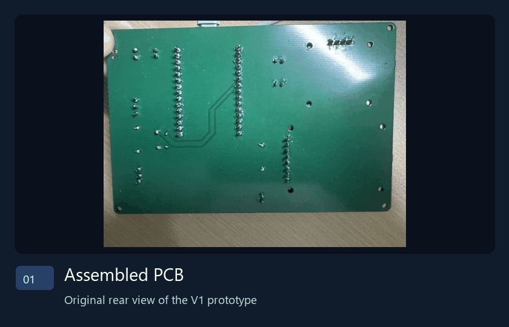
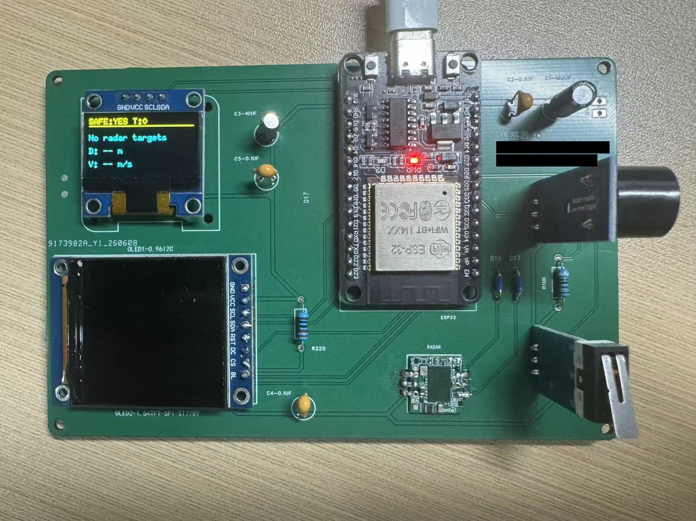
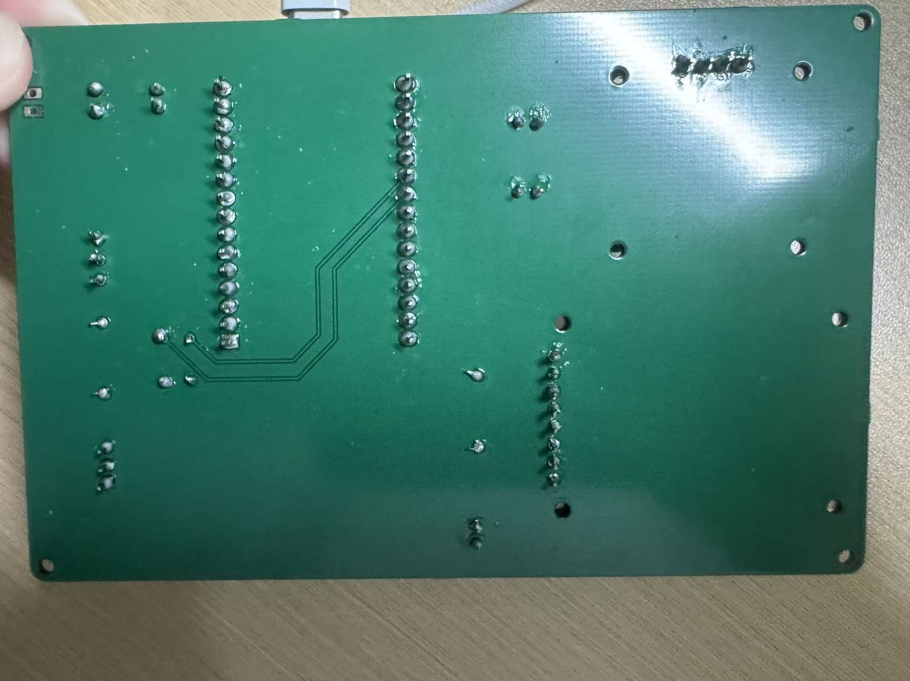

# ESP32 60 GHz Millimeter-Wave Blind-Spot Monitor

[简体中文](README.zh-CN.md)

This project builds a **rear blind-spot warning prototype for bicycles and e-bikes**. A millimeter-wave radar reports target range, relative speed and direction. The ESP32 assigns targets to left, centre and right zones, evaluates risk, and drives an OLED, an optional TFT, a buzzer and an Android display. A vibration sensor supplies a separate mechanical trigger. The phone can mute the buzzer, dismiss a false alarm, set the local alarm state or resume monitoring.

**What worked.** The team fabricated and assembled a two-layer PCB. An archived serial capture decoded a right-zone target at **2.00 m** and **+55°**. The OLED displayed two targets at approximately **8 m and 10 m**. A separate Android capture showed two targets, including a left-zone warning of **4/5** for the target at **10 m, −7.2 km/h and −16°**. The three captures are from different scenes. The ESP32 firmware and Android debug APK both built from the repository.

[Minimal reproduction](#minimal-reproduction) · [Demo walkthrough](demo/README.md) · [Editable PCB and manufacturing files](hardware/README.md) · [Firmware design](docs/design.md) · [Protocol byte by byte](docs/radar-protocol.md) · [Testing and improvements](docs/reproduce-and-test.md)

## Why the team built it

The coursework started with a rear-end collision on campus. Low speeds still leave cyclists with limited visibility to the side and rear. The project uses the MS60-1211S80M-BSD radar because it directly reports range, radial relative speed and bearing without relying on the brightness of a camera image.

The prototype has two feedback paths. **Radar targets** drive tracking and warnings. The OLED and buzzer can work with the phone disconnected. **Mechanical vibration** enters collision confirmation, with an app control for human handling. Both paths return to the monitoring loop. The alarm is a local state with no connection to an external emergency service.

~~~mermaid
flowchart LR
    R["MS60 radar Range · speed · angle"] -->|UART2 921600| F["ESP32 frame validation and target parser"]
    F --> S["Risk rules and state machine"]
    V["YL-99 vibration sensor"] -->|GPIO27| S
    S --> O["OLED / ST7789 / buzzer"]
    S -->|Status and targets| A["Android app · Bluetooth Classic SPP"]
    A -->|Mute / alarm / false alarm / reset| S
~~~

## Hardware implementation

The V1 two-layer carrier is approximately 121 × 80 mm. It mounts an ESP32-WROOM DevKit, MS60 radar, 0.96-inch SSD1306 OLED, 1.54-inch ST7789 TFT, YL-99 vibration module and an active-low buzzer. A 5 V input feeds DevKit VIN. The carrier uses the DevKit's 3.3 V supply for the corresponding peripherals. The OLED uses I²C for a quick numerical view. The TFT uses SPI for more detailed zones and state. Radar UART and the vibration GPIO can be brought up separately.

### Soldered prototype photos

| Front, powered on | Rear, solder joints and jumpers |
| --- | --- |
|  |  |

The original front photo shows the installed displays, ESP32 and radar. The OLED reads **No radar targets**. The rear photo shows the solder joints. Two lines of personal silkscreen are covered in the front photo. [Compare with the PCB layout render](demo/assets/pcb-layout.png).

| Material | What it covers |
| --- | --- |
| [EasyEDA Pro project](hardware/esp32-bsd-monitor-v1.epro2) · [Gerber and drill ZIP](hardware/esp32-bsd-monitor-v1-gerbers.zip) | Editable design and fabrication layers with personal markings removed |
| [Schematic and wiring](docs/hardware-wiring.md) · [PCB layout and assembled photos](hardware/README.md) | Supply, crossed UART signals, manual jumpers and TFT backlight |
| [PlatformIO firmware](src/main.cpp) · [Android build and pairing](android_app/README.md) | Flash the board and connect the client |

## From a radar frame to a warning

1. **Measurement.** The radar module estimates range, radial speed and angle from the beat frequency, phase across chirps and phase across receive channels. The ESP32 takes target-level reports and handles parsing, decisions and display.
2. **Frame parsing.** The ESP32 locates a frame header, waits for the bytes specified by the length and validates the checksum. A `TYPE 0x07` report contains the target count and four fields per target. The firmware stores up to eight. The [protocol walkthrough](docs/radar-protocol.md) annotates the captured 12-byte frame.
3. **Multi-target risk.** Each target is scored using its range, approach speed and the vibration input. The summary uses the highest risk, then the closest target on ties. A fresh target can enter the `WARNING` state. An audible radar warning also requires fused risk `WARN`.
4. **Display and control.** The OLED pages through targets. The TFT and Android app visualise the zones. The phone receives both summary and per-target data and sends four commands back to the ESP32. The firmware resumes monitoring when the current observations and latched state allow it.

## Interpreting the results and improving V1

The report and defense show the prototype's functional data path. They do not establish maximum detection range, calibrated accuracy or a long-run false-alarm rate. Late SPI display rework damaged the controller. The original assembly could not continue testing and the electrical root cause was not isolated. Start the next revision with removable peripherals and current-limited supply branches, then add serial replay and measured-distance tests. Use those data to tune the thresholds and controls. [Test matrix and improvement order](docs/reproduce-and-test.md)

## Minimal reproduction

| Item | Required or verified configuration |
| --- | --- |
| Hardware | ESP32-WROOM-32 DevKit, MS60-1211S80M-BSD radar, 3.3 V SSD1306 I²C OLED, USB data cable and the correct supply. Buzzer, YL-99, ST7789 and an Android phone extend the test. |
| Hardware revision | The coursework photos and readings come from the soldered **V1 two-layer carrier**. The public PCB and Gerbers retain the V1 copper, mask and drill data with personal silkscreen removed. |
| Firmware | PlatformIO Core 6.1.19, Espressif32 6.13.0, Arduino, target `esp32dev`. [Pinned libraries](platformio.ini) |
| Android | JDK 17, Android SDK 35, Gradle 8.7 and AGP 8.6.1. The ESP32 must support Bluetooth Classic SPP. |
| Reproducible source baseline | Both binaries built at [d85f341](https://github.com/YohtHill/esp32-bsd-radar-monitor-public/tree/d85f341030313134933a54d3fb5ad6238b598857). [GitHub Actions](https://github.com/YohtHill/esp32-bsd-radar-monitor-public/actions/runs/45001575628) |

1. **Wire with power off.** Connect radar TX to GPIO16 and RX to GPIO17. Connect OLED SDA to GPIO21 and SCL to GPIO22. The V1 carrier powers both modules from 3.3 V. Share ground and check supply and UART levels against the [schematic and pin map](docs/hardware-wiring.md). Check the hand-wired UART jumpers if using the V1 carrier.
2. **Build and flash.** Install PlatformIO Core 6.1.19 with `python -m pip install platformio==6.1.19` or use the PlatformIO IDE terminal. Run the commands below from the repository root. If several serial devices are attached, use `pio device list` and supply `--upload-port <port>` to the upload command.
3. **Check the minimum output.** The USB monitor should show `Radar UART: 921600 8N1, RX=16, TX=17`. Move one target in front of the radar in an open area. Look for `REPORT RX type=0x07`, the decoded range, bearing and speed, and the corresponding OLED output. Link status or Bluetooth startup alone does not verify that target data reached the parser.
4. **Connect the phone.** Build with the [Android pairing guide](android_app/README.md), pair with `ESP32_BSD_MONITOR` in system settings and connect in the app. Use the [bench matrix](docs/reproduce-and-test.md) to exercise impact, false-alarm handling, reset and disconnect.

~~~sh
pio run -e esp32dev
pio run -e esp32dev -t upload
pio device monitor -b 115200
~~~

## Measurements and validation scope

| Metric | Evidence |
| --- | --- |
| Range | One archived UART report reads 2.00 m. A different OLED capture shows two targets near 8 m and 10 m. Maximum detection distance and errors against a reference remain unmeasured. |
| Updates | The module manual lists 100 ms. Firmware schedules OLED and Bluetooth updates at 250 ms and TFT refresh at 1000 ms, with some immediate events. End-to-end latency remains unmeasured. |
| Conditions | V1 records include power-on, UART decoding and two-target display. Near-field reflections and mounting angle affected the prototype. There is no long-duration false-alarm or missed-detection dataset. |

The repository keeps firmware in [src/](src/), the client in [android_app/](android_app/), PCB design in [hardware/](hardware/), photos and app captures in [demo/](demo/), and the bench checklist and protocol in [docs/](docs/).
