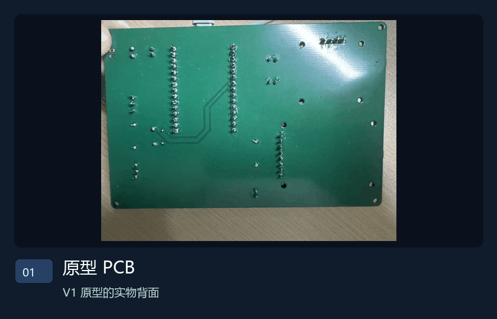
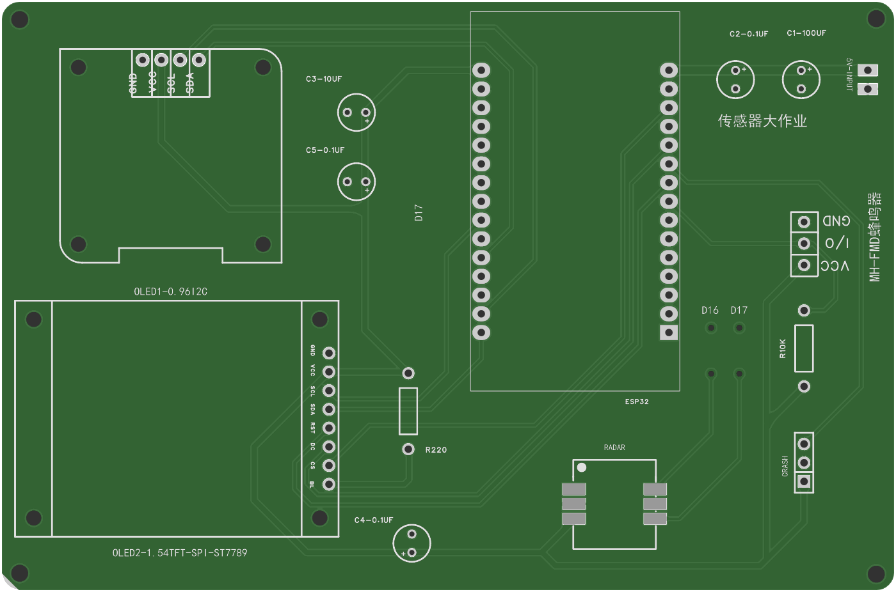

# ESP32 60 GHz 毫米波雷达盲区追尾预警原型

[English](README.md)

这个项目为电动车和自行车做了一套**后方盲区预警原型**。雷达负责报告目标的距离、相对速度和方向，ESP32 将目标划分为左、中、右三个区域并判定风险。OLED、可选彩屏和安卓 App 显示结果，蜂鸣器提供本地提示。独立的振动传感器检测机械触发，手机可以静音、标记误报、进入本地报警状态，或恢复监测。

**实际做出来的效果。** 项目完成了双层 PCB 打板和焊接。原始串口记录成功解出一条距离 **2.00 米**、方位 **+55°** 的右侧目标。OLED 显示过约 **8 米和 10 米** 的两个目标。另一次安卓截图中，两个目标同时出现在列表，左侧 **10 米、−7.2 km/h、−16°** 的目标触发了 **4/5** 级预警。三个画面来自不同实验记录。ESP32 固件和安卓调试包均已在仓库版本上构建通过。

[逐帧看演示](demo/README.zh-CN.md) · [下载可编辑 PCB 和制造包](hardware/README.zh-CN.md) · [固件设计](docs/design.zh-CN.md) · [逐字节读协议](docs/radar-protocol.zh-CN.md) · [测试与后续改进](docs/reproduce-and-test.zh-CN.md)

## 为什么做这套系统

选题源于课程组经历的一次校园骑行追尾。侧后方遮挡和短暂注意力转移也会出现在低速场景，后方目标快速靠近时，需要骑行者能及时看到提示。项目选择 MS60-1211S80M-BSD 雷达，是因为它能直接输出距离、径向相对速度和角度，不依赖摄像头画面的亮度。

方案保留两条反馈路径。**雷达目标**进入跟踪和预警，本地 OLED 与蜂鸣器在手机断开时仍可工作。**机械振动**进入碰撞确认，App 提供人工处置。两条路径最后回到监测循环。这里的“报警”是本地状态，没有接入外部紧急服务。

~~~mermaid
flowchart LR
    R["MS60 雷达 距离 · 速度 · 角度"] -->|UART2 921600| F["ESP32 帧校验与多目标解析"]
    F --> S["风险判定 · 状态机"]
    V["YL-99 振动传感器"] -->|GPIO27| S
    S --> O["OLED / ST7789 / 蜂鸣器"]
    S -->|状态和目标列表| A["安卓 App · 经典蓝牙 SPP"]
    A -->|静音 / 报警 / 误报 / 复位| S
~~~

## 硬件是怎么做的

V1 将 ESP32-WROOM DevKit、MS60 雷达、0.96 英寸 SSD1306 OLED、1.54 英寸 ST7789、YL-99 和低电平触发蜂鸣器集成在约 121 × 80 毫米的双层载板上。5 V 输入接开发板 VIN，板上用 3.3 V 给相应外设供电。OLED 走 I²C，用于快速看目标和状态。彩屏走 SPI，用于显示更丰富的分区与状态信息。雷达串口和机械触发分别用 UART2 和数字 GPIO，便于逐个通电和排查。

| 资料 | 用途 |
| --- | --- |
| [嘉立创 EDA 专业版工程](hardware/esp32-bsd-monitor-v1.epro2) · [Gerber 与钻孔包](hardware/esp32-bsd-monitor-v1-gerbers.zip) | 可编辑工程及脱敏后的制造输出 |
| [原理图和接线](docs/hardware-wiring.zh-CN.md) · [PCB 布线与实物背面](hardware/README.zh-CN.md) | 核对供电、雷达 TX/RX 交叉接线、手工跳线及彩屏背光 |
| [PlatformIO 固件](src/main.cpp) · [安卓构建与配对](android_app/README.zh-CN.md) | 烧录 ESP32 和连接安卓客户端 |

## 一帧目标怎样变成预警

1. **雷达测量。** 模块用 FMCW 的拍频、chirp 间相位变化和接收通道间相位差估计距离、径向速度、角度。ESP32 接收目标级数据，所以它的计算集中在解析、决策和显示。
2. **串口解析。** ESP32 从字节流找帧头，按长度收齐候选帧并校验。收到 `TYPE 0x07` 后读取目标数和每个目标的距离、角度、速度、ID，最多保存八个目标。报告里的 12 字节实测帧可用[协议图解](docs/radar-protocol.zh-CN.md)逐项核对。
3. **多目标判定。** 程序逐目标结合距离、靠近速度和振动输入计算 `TRACK`、`NEAR`、`WARN` 或 `HIT`。摘要选风险最高者，同级取最近。`WARNING` 状态可由有效目标触发，雷达蜂鸣还要求融合风险达到 `WARN`。
4. **显示与处置。** OLED 分页列出目标，彩屏和安卓 App 显示分区。蓝牙上传总体和逐目标字段，App 的四种命令回传 ESP32。清除或超时后，系统按当前目标与锁存状态重新选择监测状态。

## 如何看待结果与下一版

课程报告和答辩记录支持这是一套能跑通数据链路的原型。截图和一次串口帧无法证明探测距离上限、测量精度或长期误报率。课程后期返修 SPI 彩屏时出现电路异常并损坏主控，原样机此后无法继续测试，故障源未做电气定因。后续优先做可插拔、可分路限流的 V2，再补可复现的串口回放和定距测试，最后根据数据调整预警阈值与交互。[查看验证矩阵和改进顺序](docs/reproduce-and-test.zh-CN.md)

## 快速构建

先核对[接线和电源](docs/hardware-wiring.zh-CN.md)。ESP32 固件使用 Arduino 与 PlatformIO。经典蓝牙 SPP 客户端应配对 `ESP32_BSD_MONITOR`。如需逐项上电、排查串口或安装 APK，参照[台架复现](docs/reproduce-and-test.zh-CN.md)与[安卓构建](android_app/README.zh-CN.md)。

~~~sh
pio run
pio run -t upload
pio device monitor -b 115200
~~~
