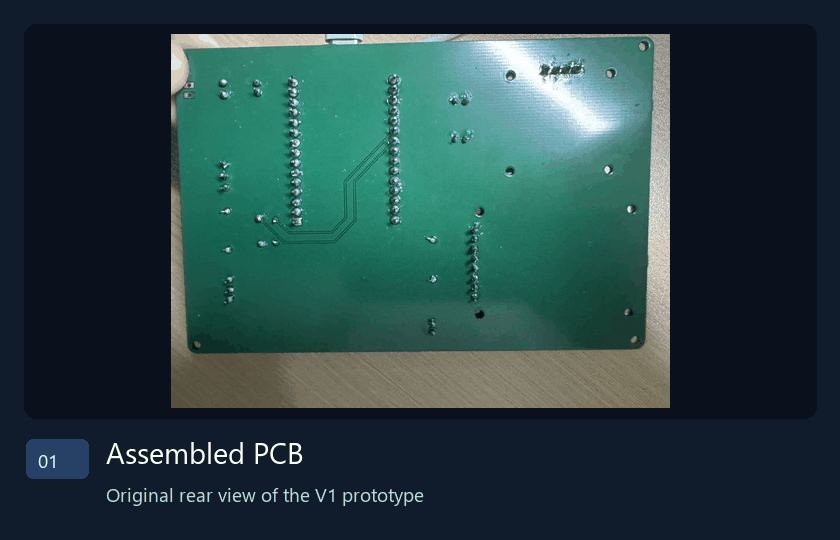

# Prototype Demonstration

[简体中文](README.zh-CN.md) · [Project home](../README.md)

The animation combines three still captures from the coursework record. Each capture shows its own test scene.

| Evidence | What is visible |
| --- | --- |
| [Rear of assembled board](assets/assembled-back.jpg) | The original rear photo shows the hand-soldered carrier. The [top-side render](assets/pcb-layout.png) shows the module and display positions on the same layout. |
| [OLED capture](assets/oled-two-targets.jpg) | Two targets at about 8 m and 10 m. Both displayed speeds are approximately −2 m/s. |
| [Android capture](assets/android-warning.jpg) | Two targets are visible in the target table. The left-zone target is shown at 10.00 m, −7.2 km/h and −16° with danger level 4/5. The centre target is shown at 4.00 m, −3.6 km/h and 3° with level 2/5. |

The firmware serial capture in the report also recorded a type 0x07 report with one target at 2.00 m and +55°. See the [bench guide](../docs/reproduce-and-test.md) for repeatable checks.
