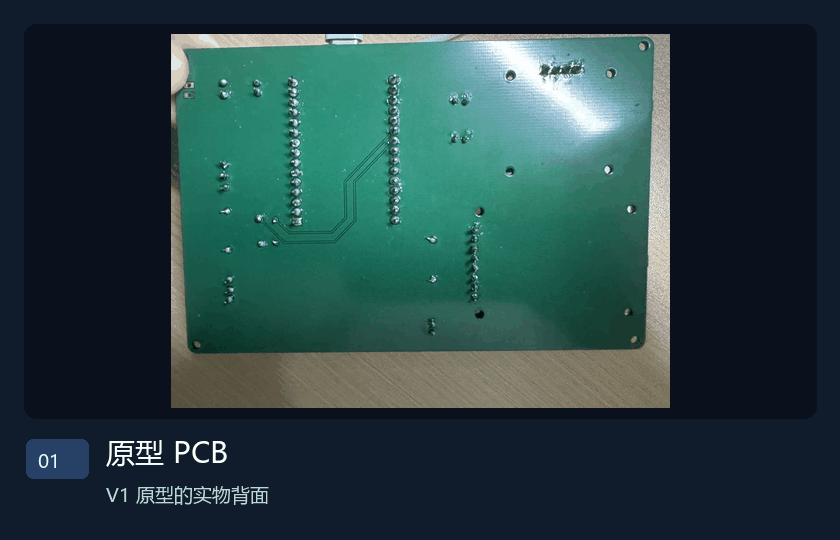

# 原型演示

[English](README.md) · [项目首页](../README.zh-CN.md)

动图由课程报告中的三张静态画面组成，每张画面对应各自的测试场景。

| 素材 | 画面内容 |
| --- | --- |
| [原型实物正面](assets/assembled-front-redacted.png)和[背面](assets/assembled-back.jpg) | 正面实拍显示 OLED 已上电且无目标，背面记录了手工焊接的焊点。 |
| [OLED 截图](assets/oled-two-targets.jpg) | 同时显示约 8 米和 10 米的两个目标，两者显示速度均约为 −2 米/秒。 |
| [安卓预警截图](assets/android-warning.jpg) | 目标列表包含两条风险记录。左侧目标为 10.00 米、−7.2 千米/小时、−16°，风险 4/5；中间目标为 4.00 米、−3.6 千米/小时、3°，风险 2/5。 |

报告的串口截图还记录了一条类型为 0x07 的单目标上报，距离 2.00 米、角度 +55°。需要重现实验时可参照[台架测试](../docs/reproduce-and-test.zh-CN.md)。
