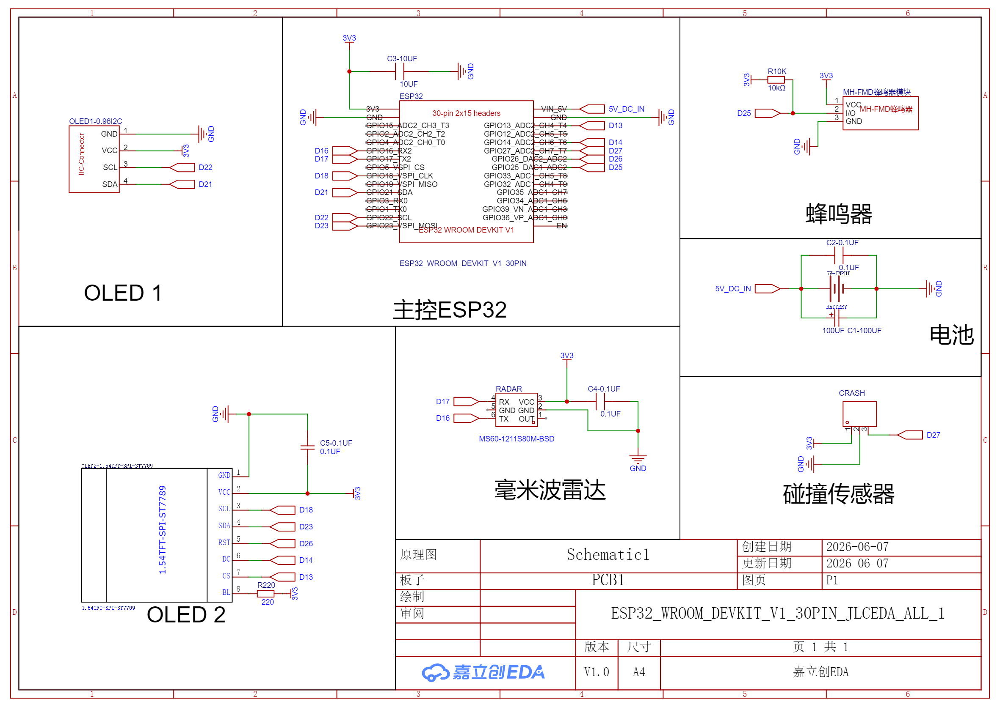

# Hardware Wiring

[简体中文](hardware-wiring.zh-CN.md) · [PCB files](../hardware/README.md)

| Module | Signal | ESP32 | Notes |
| --- | --- | --- | --- |
| MS60 radar | TX / RX | GPIO16 / GPIO17 | Cross TX and RX. Verify the manual jumpers in the assembled V1 carrier. |
| MS60 radar | VCC | 3.3 V on V1 | Match the supply and UART level to your module. |
| SSD1306 OLED | SDA / SCL | GPIO21 / GPIO22 | I²C, 3.3 V. |
| Vibration input | DO | GPIO27 | Active low. |
| Buzzer | I/O | GPIO25 | Active low. |
| Optional ST7789 TFT | SCK / MOSI | GPIO18 / GPIO23 | SPI, 3.3 V. |
| Optional ST7789 TFT | CS / DC / RST | GPIO13 / GPIO14 / GPIO26 | Keep these distinct from the OLED I²C lines. |
| TFT backlight | BL | GPIO32 in the firmware | The V1 schematic instead ties BL to 3.3 V through 220 Ω. |

Connect all grounds to ESP32 GND. The 5 V input on the carrier connects to DevKit VIN. The schematic shows a 100 µF reservoir on the input and 0.1 µF local bypass capacitors. Check power, polarity, module pin order and continuity before firmware bring-up.

