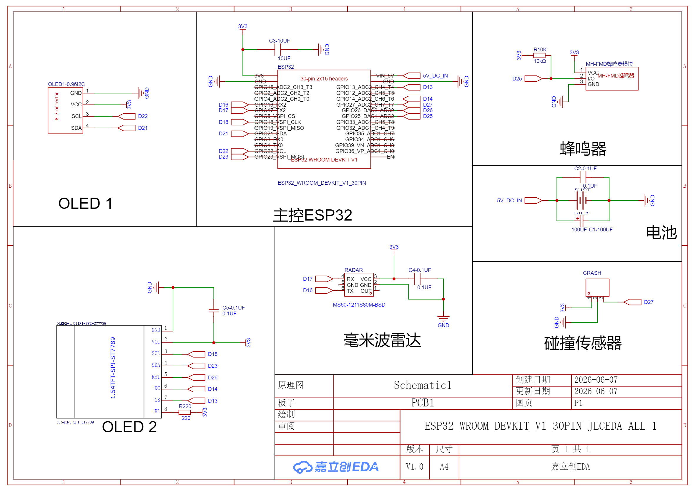

# 硬件接线

[English](hardware-wiring.md) · [PCB 文件](../hardware/README.zh-CN.md)

| 模块 | 信号 | ESP32 | 说明 |
| --- | --- | --- | --- |
| MS60 雷达 | TX / RX | GPIO16 / GPIO17 | TX、RX 交叉连接。检查 V1 实物上的手工跳线。 |
| MS60 雷达 | VCC | V1 使用 3.3 V | 按实际模块核对供电与串口电平。 |
| SSD1306 OLED | SDA / SCL | GPIO21 / GPIO22 | I²C，3.3 V。 |
| 振动输入 | DO | GPIO27 | 低电平有效。 |
| 蜂鸣器 | I/O | GPIO25 | 低电平有效。 |
| 可选 ST7789 彩屏 | SCK / MOSI | GPIO18 / GPIO23 | SPI，3.3 V。 |
| 可选 ST7789 彩屏 | CS / DC / RST | GPIO13 / GPIO14 / GPIO26 | 与 OLED 的 I²C 信号分开接线。 |
| 彩屏背光 | BL | 固件配置 GPIO32 | V1 原理图中 BL 经 220 Ω 电阻接 3.3 V。 |

各模块与 ESP32 共地。载板的 5 V 输入接 DevKit VIN。原理图包含输入端 100 µF 储能电容和器件附近 0.1 µF 去耦电容。通电前核对电源、极性、引脚顺序及导通情况。

