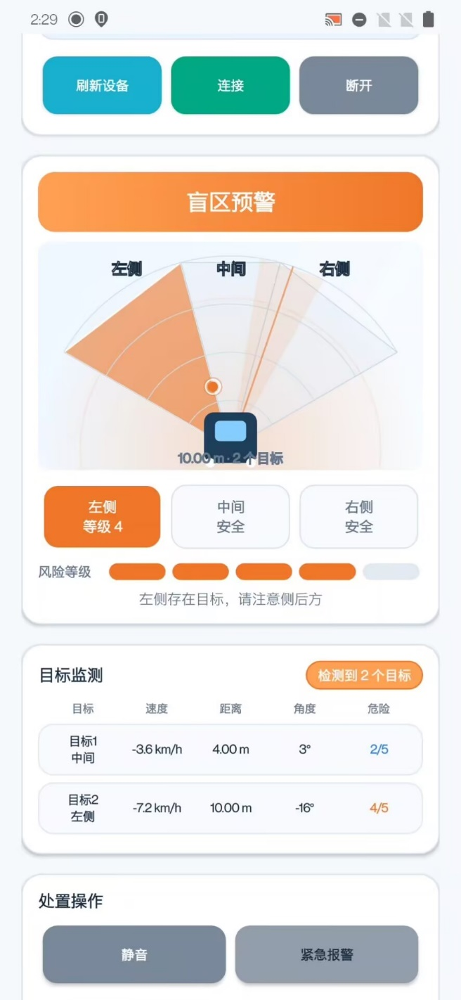

# Bench Reproduction, Evidence and V2 Priorities

[简体中文](reproduce-and-test.zh-CN.md) · [Project home](../README.md) · [Protocol and captured frame](radar-protocol.md)

## What the existing evidence supports

| Evidence | Observation | What it verifies |
| --- | --- | --- |
| [V1 hardware front](../demo/assets/assembled-front-redacted.png) and [rear](../demo/assets/assembled-back.jpg) | The OLED is on and shows no target in the front photo. The rear view shows the soldered carrier. | Physical fabrication, assembly and one archived idle display. |
| Original UART frame on Slide 9 | `5A 09 07 01 00 00 00 02 37 00 00 A4` decoded as 2.00 m, 0.00 m/s, +55°, ID 0, right zone. | One checksum-valid report and its firmware decode. |
| [OLED with two targets](../demo/assets/oled-two-targets.jpg) | Approximately 8 m on the left and 10 m in the centre, both shown near −2 m/s. | The local count and multi-target display. |
| [Android warning](../demo/assets/android-warning.jpg) | In another scene, 4 m in the centre and 10 m on the left. The left target reaches 4/5. | Bluetooth delivery to the sector view, target table and warning indicator. |
| Coursework Sections 4 and 7 and defense Slide 12 | The team recorded warnings and buzzer behaviour on approach and the confirmation stage after mechanical activation. | Functional coursework trials without per-event timing, trial counts or false-alarm statistics. |
| ESP32 firmware and Android app build | PlatformIO compiled the firmware and the Android build generated a debug APK. | Toolchain reproduction. It does not repeat the hardware tests. |

The OLED, phone and UART captures come from different scenes. Their values are radar readings. Measuring absolute error needs independent reference measurements in the same trial.

## Bring up the board in stages

1. **Prepare the hardware.** Check VIN, 3.3 V, ground and radar UART continuity against the [schematic and pin map](hardware-wiring.md). Inspect for reversed parts, solder bridges and shorts. Start with a current-limited supply and the ESP32 plus OLED, then add radar, vibration sensor, buzzer and SPI display.
2. **Flash the board.** Run `pio run -t upload` and open `pio device monitor -b 115200`. Look for `ESP32_BSD_MONITOR`, the radar pins and the 921600 baud setting. Check that the OLED shows no targets and the buzzer is quiet.
3. **Verify the radar link before the displays.** Point the module into an open area and move one target. First check whether `rxBytes` and `validFrames` rise in `LINK` logs. Then look for `REPORT RX type=0x07` and target JSON. Check velocity sign with known movement and then cross the zones.
4. **Connect Android.** Build and install the app with the [Android guide](../android_app/README.md). Pair through system settings and select the ESP32 in the app. Check target count, zone, level and command feedback.
5. **Isolate impact and confirmation.** With the board fixed, tap the vibration module and look for a `C_COUNT` increment and a confirmation prompt. USB serial accepts `MUTE`, `FALSE` and `RESET` for local command checks. Use `ALARM` to inspect the local alarm state.

## Reproduction matrix

These are expectations from the current code. Record outcomes and verify the sign after mounting the radar.

| Scenario | Expected result |
| --- | --- |
| One target beyond 4 m and at most 8 m, approaching at about 1 m/s | `WARN` and the radar-warning buzzer cadence. |
| Target within 4 m, with no mechanical activation | `NEAR`. Very small ranges can raise the display level. Collision confirmation requires the mechanical input. |
| 10 m target at about −2 m/s and 4 m target at about −1 m/s | The 10 m target reaches `WARN` and both records remain visible. |
| Valid empty report or non-empty frame older than 2 s | Normal monitoring clears or ignores old targets. Confirmation or alarm can still await handling. |
| Stable vibration activation and release | One count for the debounced activation and entry to `COLLISION_CONFIRM`. |
| Send `FALSE` or `RESET` from confirmation | False-alarm recovery follows after about 2 s. Reset reselects state immediately and keeps the cumulative count. |
| Disconnect Bluetooth | Phone updates stop. ESP32 continues the local radar, OLED and buzzer loop. |

### Troubleshooting

| Symptom | First checks |
| --- | --- |
| `rxBytes` stays flat | Check 3.3 V, shared ground, crossed signals, V1 jumpers and radar TX idle level. |
| Bytes arrive but few or no valid frames | Verify 921600 baud, 8N1 and signal integrity. The `noise` field counts discarded bytes. |
| Valid frames increase but no target appears | Replies and other report types count as valid frames too. Check for `TYPE 0x07`, sensing enabled and a target in view. |
| OLED works and phone is idle | Check Bluetooth Classic SPP support on the specific ESP32, phone permissions, system pairing and app connection. |
| OLED works and SPI TFT is dark | Power off, then inspect the flex, backlight supply and SCK/MOSI/CS/DC/RST. V1 ties the backlight differently from the firmware's GPIO32 option. |

## V2 priorities

1. **Recover a serviceable prototype.** Section 7 and Slide 14 record an SPI display fault and a damaged ESP32 after late rework. The electrical cause was not isolated. Use removable connectors for the display, radar and DevKit, add branch current limiting and test points, and record the 5 V, 3.3 V and backlight rails while bringing up one module at a time.
2. **Make results repeatable and measurable.** Save timestamped good, bad-checksum, truncated, empty and dual-target serial captures for replay. Use marked ranges and angles in an open area and in a corridor. Record reference positions, true approach or departure, frame freshness and the first Android or buzzer warning.
3. **Tune rules from the measurements.** Calculate range error, detection rate, false alarms, missed events and end-to-end latency. Then evaluate multi-frame confirmation or hysteresis around thresholds. Give stale radar data and an empty scene distinct indicators.
4. **Extend the application after bench validation.** Test whether warnings are easy to read, whether acknowledgement recovers correctly, and then evaluate tail-light integration, lane-change prompts, mounting and controlled cycling trials.

The current V1 firmware, PCB and archived captures are the baseline for this plan.
