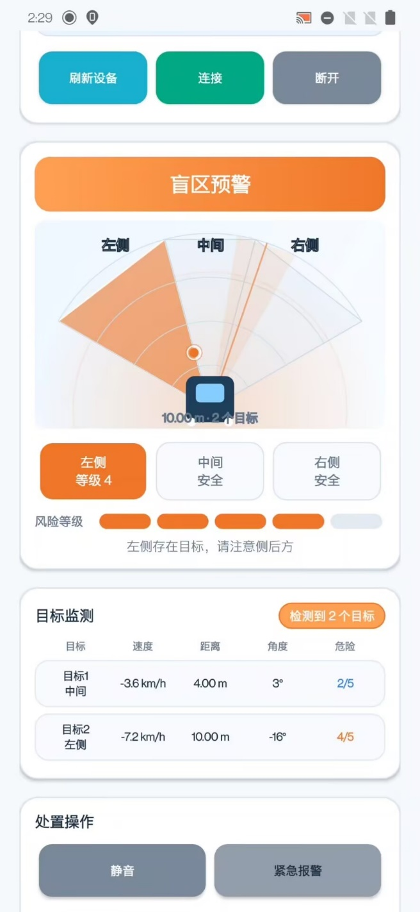

# 台架复现、试验结果与 V2 改进

[English](reproduce-and-test.md) · [项目首页](../README.zh-CN.md) · [协议和测试帧](radar-protocol.zh-CN.md)

## 已有记录能说明什么

| 证据 | 观察到的现象 | 验证范围 |
| --- | --- | --- |
| [V1 实物](../demo/assets/assembled-back.jpg) | 背面照片显示完成焊接的载板。 | 双层载板已打板装配。 |
| 答辩第 9 页原始串口帧 | `5A 09 07 01 00 00 00 02 37 00 00 A4`。解码为右侧 2.00 米、0.00 米/秒、+55°，ID 0。 | 一次合法串口帧及解码结果。 |
| [OLED 双目标](../demo/assets/oled-two-targets.jpg) | 左侧约 8 米、中间约 10 米，两者显示约 −2 米/秒。 | OLED 的目标数和多目标显示。 |
| [安卓预警](../demo/assets/android-warning.jpg) | 另一场景同时出现中间 4 米与左侧 10 米两个目标。左侧达到 4/5 级。 | 蓝牙链路到分区、目标列表和风险显示。 |
| 课程报告第 4 节、第 7 节与答辩第 12 页 | 小组记录过接近时提高风险与蜂鸣提示，并在机械触发后进入确认流程。 | 课程功能测试，记录未提供逐事件时间戳、重复次数或误报率。 |
| ESP32 和安卓构建 | PlatformIO 固件编译通过，Android 调试 APK 构建通过。 | 可构建性，不等同于实物重新上电。 |

OLED、手机和串口画面来自不同记录，不能拼成同一个事件的时间线。距离、角度和速度是雷达显示值。要计算绝对误差，必须拿这些显示值与独立量具测得的参考值比较。

## 分步上电

1. **准备硬件。** 先按[原理图和引脚表](hardware-wiring.zh-CN.md)核对 VIN、3.3 V、共地以及雷达 TX/RX 的导通。检查反贴、焊桥与短路。首次上电使用带限流的电源，先带主控和 OLED，再接雷达、振动、蜂鸣器和 SPI 彩屏。
2. **烧录主控。** 执行 `pio run -t upload`，以 `pio device monitor -b 115200` 打开 USB 串口。应看到 `ESP32_BSD_MONITOR`、雷达 UART 引脚和 921600 波特率。OLED 应能显示无目标，蜂鸣器保持静音。
3. **先验串口再看屏幕。** 雷达朝向开阔方向，移动单个目标。先确认 `LINK` 的 `rxBytes`、`validFrames` 有增长，再找 `REPORT RX type=0x07` 及目标 JSON。用固定方向的运动先检查正负速度，再做左右跨区。
4. **连接手机。** 按[安卓说明](../android_app/README.zh-CN.md)构建和安装 APK，先在系统蓝牙设置中配对。随后在 App 刷新、选择、连接，逐个检查目标列表、分区和指令回显。
5. **单独测试机械触发和确认。** 固定支架后轻触振动模块，观察 `C_COUNT` 是否加一、App 是否进入确认。不连手机时也可通过 USB 输入 `MUTE`、`FALSE`、`RESET`，检查本地处置。`ALARM` 用来观察本地报警状态。

## 测试矩阵

所有值应记录在测试表里。下面是按当前代码推导的预期，可据此复测。方向符号要在安装完成后先核对。

| 场景 | 预期 |
| --- | --- |
| 单目标以约 1 米/秒靠近，读数在 4 米外到 8 米之间 | `WARN`，进入雷达预警节奏。 |
| 近距离目标在 4 米以内，振动无效 | `NEAR`。距离很近会提高界面等级，仍需机械输入才进入碰撞确认。 |
| 10 米目标约 −2 米/秒，同时有 4 米目标约 −1 米/秒 | 10 米目标由快速靠近规则进入 `WARN`，按两条记录上报。 |
| 收到合法零目标帧，或非零目标帧超过 2 秒 | 常规监测清除或停止使用旧目标。在确认或报警状态下，仍需人工处置。 |
| 振动输入稳定激活后释放 | 一次稳定激活计数一次，并进入 `COLLISION_CONFIRM`。 |
| 确认状态发 `FALSE`，或发 `RESET` | 前者标记误报并在约 2 秒后恢复。后者立即恢复状态选择并保留累计计数。 |
| 蓝牙断开 | 手机停止接收。本地 OLED、雷达和蜂鸣器仍由 ESP32 主循环处理。 |

### 看到异常时先查哪里

| 现象 | 优先核对 |
| --- | --- |
| `rxBytes` 不增长 | 核对 3.3 V、GND、TX/RX 交叉、V1 跳线和模块 TX 空闲电平。 |
| `rxBytes` 增长但 `validFrames` 很少或为零 | 先核对 UART 921600、8N1 与电平质量。`noise` 是被丢弃字节累计数。 |
| `validFrames` 增长但暂无目标 | 有效应答或其它类型上报也会计数。检查是否出现 `TYPE 0x07`、是否开启感知及目标是否在场。 |
| OLED 有数据、手机没数据 | 检查是否使用支持经典蓝牙 SPP 的 ESP32 型号、安卓权限、配对与 App 连接。 |
| OLED 正常但 SPI 彩屏黑 | 断电检查彩屏排线、背光电源路径和 SCK/MOSI/CS/DC/RST。V1 背光硬件与固件 GPIO32 走线不同。 |

## 下一版优先级

1. **先恢复一个可维护的样机。** 课程报告第 7 节和答辩第 14 页记录了 SPI 彩屏返修后电路异常和主控损坏，原因未隔离。把屏、雷达和 DevKit 改为可拔插连接，给外设和背光留分路限流及测试点。V2 装配时分模块启动并记录 5 V、3.3 V、背光支路电压和电流，再做长期运行。
2. **让结果可重复量化。** 保留带时间戳的正确帧、坏校验帧、截断帧、零目标帧和双目标帧，先做串口回放。实物用标记距离和角度建立对照，在开阔场地与走廊各测一组，同时记录实测距离、目标是否真正接近、帧新鲜度、App 和蜂鸣时间。
3. **用测量结果调整逻辑。** 从记录计算距离误差、有效目标率、每场景误报/漏报和端到端延迟，再试多帧确认或迟滞来减少阈值附近抖动。增加“雷达离线/数据过期”与“确实没有目标”的不同界面状态，减少把断链理解成安全的机会。
4. **最后扩展应用。** 在验证分区、提示可读性、确认和复位不扰动监测之后，再验证尾灯联动、变道提示、装车防护和受控骑行场景。

这些步骤是下一版计划。仓库的 V1 固件、PCB 和历史画面提供基线。
