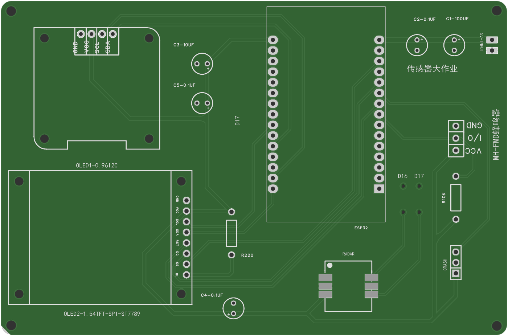

# PCB Design and Fabrication Files

[简体中文](README.zh-CN.md) · [Project home](../README.md)

The fabricated V1 prototype is a two-layer carrier with an outline of approximately 121.0 × 80.0 mm from the Gerber. The ESP32-WROOM DevKit is in the middle. The OLED and TFT footprints are on the left, the radar footprint is near the bottom, and the buzzer and vibration input are on the right. The power input is marked 5 V and feeds the DevKit VIN. Peripherals share the 3.3 V rail and GND.

| File | Use |
| --- | --- |
| [EasyEDA Pro archive](esp32-bsd-monitor-v1.epro2) | Edit the schematic and PCB in EasyEDA Pro. Download the archive and import it through the Professional Edition import entry. |
| [Gerber and drills](esp32-bsd-monitor-v1-gerbers.zip) | Fabrication layers derived from the 2026-06-07 export. Includes both copper layers, mask, silkscreen, outline, PTH, NPTH and via drill files. |
| [Schematic reference](../docs/reference-schematic.png) | Read the power path and interface labels without the editor. |
| [Top-side render](../demo/assets/pcb-layout.png), [front photo](../demo/assets/assembled-front-redacted.png) and [rear photo](../demo/assets/assembled-back.jpg) | Compare the layout with the installed parts, solder joints and manual jumpers. |

In this public edition, the two personal markings were removed from the editable PCB, its embedded preview and the top-silkscreen Gerber. The copper, solder mask, outline and drill layers match the original bytes. The ZIP includes fabrication layers. The source archive was checked structurally. The report records manual jumpers on the radar UART path. When populating a new board, check continuity from radar TX to ESP32 GPIO16 and from radar RX to GPIO17 against the [pin map](../docs/hardware-wiring.md). The Gerber ZIP was rendered and inspected. The modified source has not been re-exported from EasyEDA Pro or re-run through DRC.

## Design choices and rework lessons

The DevKit provides USB flashing and 3.3 V regulation. The two displays use separate I²C and SPI interfaces so the OLED can be used during TFT bring-up. The schematic uses a 100 µF reservoir at the 5 V entry and 0.1 µF local bypass capacitors. The report describes a large ground area on the bottom layer and signal routing mainly on the top layer.

The V1 radar footprint required manual UART jumpers on the assembled board. Verify the receive and transmit paths at the module pads before powering it. The schematic feeds the TFT backlight from 3.3 V through 220 Ω, while the firmware has a GPIO32 option for a separately wired module. Check which applies to the assembly in front of you.

The report and defense describe a late SPI display rework followed by a fault and a damaged ESP32. For the next board, use removable display and radar connectors, isolate supply branches during first power-on, and make the backlight rail and radar UART accessible at test points. [Bring-up and verification order](../docs/reproduce-and-test.md)

[EasyEDA Pro import guide](https://prodocs.easyeda.com/en/import-export/import-easyeda-pro/)
