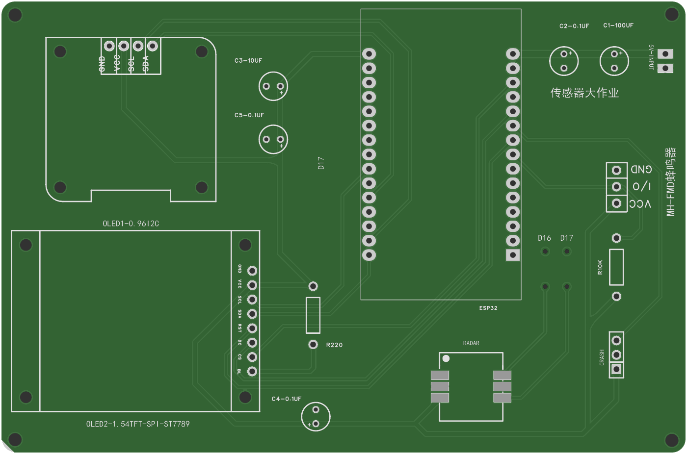

# PCB 设计与制造文件

[English](README.md) · [项目首页](../README.zh-CN.md)

V1 原型是一块已打板的双层载板，按 Gerber 外形计算，尺寸约为 121.0 × 80.0 毫米。ESP32-WROOM DevKit 位于中央，OLED 和 TFT 位于左侧，雷达位于下方，蜂鸣器和振动输入位于右侧。标记为 5 V 的电源入口接开发板 VIN，外设共用 3.3 V 与地。

| 文件 | 用途 |
| --- | --- |
| [嘉立创 EDA 专业版工程](esp32-bsd-monitor-v1.epro2) | 下载后通过专业版工程导入入口打开，可编辑原理图与 PCB。 |
| [Gerber 和钻孔包](esp32-bsd-monitor-v1-gerbers.zip) | 基于 2026-06-07 原始导出的脱敏制造包，含双面铜层、阻焊、丝印、板框、金属化孔、非金属化孔和过孔钻孔文件。 |
| [参考原理图](../docs/reference-schematic.png) | 无需打开 EDA 即可查看电源路径和接口标识。 |
| [顶层布线渲染图](../demo/assets/pcb-layout.png)、[实物正面](../demo/assets/assembled-front-redacted.png)和[实物背面](../demo/assets/assembled-back.jpg) | 对照布局，查看实物元件、焊点和手工跳线。 |

公开版在可编辑 PCB、内嵌预览和顶层丝印 Gerber 中移除了两行个人标识。双面铜层、阻焊、板框和钻孔与原始导出逐字节一致。ZIP 保留打板所用层，EDA 工程已核对压缩包结构。报告记录了雷达串口的手工跳线。装配新板时，对照[引脚表](../docs/hardware-wiring.zh-CN.md)检查雷达 TX 到 GPIO16、雷达 RX 到 GPIO17 的导通。本次已渲染并检查 Gerber。本公开版尚未在嘉立创 EDA 中重新导出或执行 DRC。

## 设计取舍与返修记录

使用 DevKit 便于通过 USB 下载，并使用板载 3.3 V 稳压。两块屏分开使用 I²C 和 SPI，排查彩屏时仍可用 OLED 查看状态。原理图在 5 V 入口放置 100 µF 储能电容，并在器件附近使用 0.1 µF 去耦。报告记录了底层大面积铺地、顶层以信号布线为主的设计。

V1 实物的雷达串口需要手工跳线。通电前，应在模块焊盘核对收发路径是否导通。V1 原理图中，彩屏背光经 220 Ω 接 3.3 V。固件另有 GPIO32 选项用于单独接线的模块，请按实物确认背光走法。

报告和答辩记录了后期返修 SPI 彩屏后出现故障、ESP32 损坏的情况。下一版可以改用可插拔的显示屏和雷达连接器，首次上电逐支路接入，并给背光电源与雷达 UART 留测试点。[分步上电和验证顺序](../docs/reproduce-and-test.zh-CN.md)

[嘉立创 EDA 专业版导入说明](https://prodocs.easyeda.com/en/import-export/import-easyeda-pro/)
